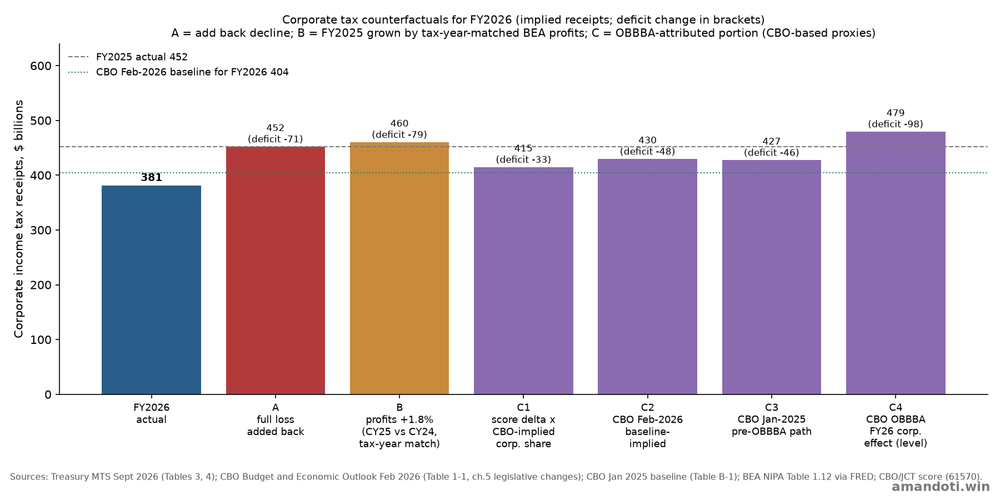
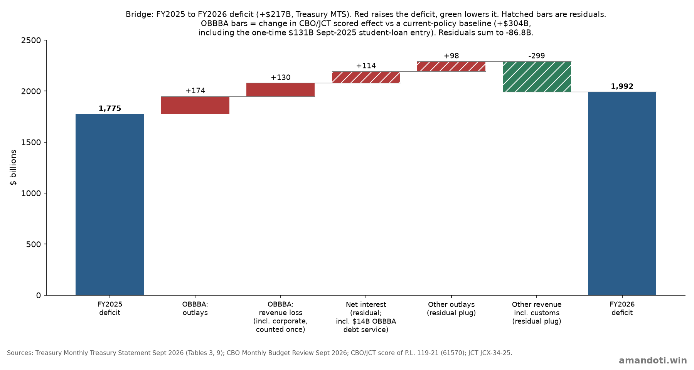
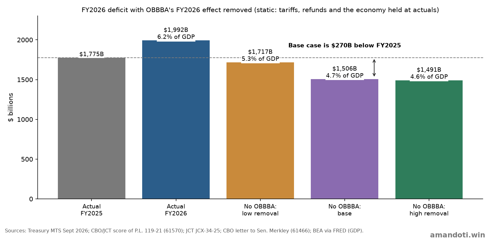
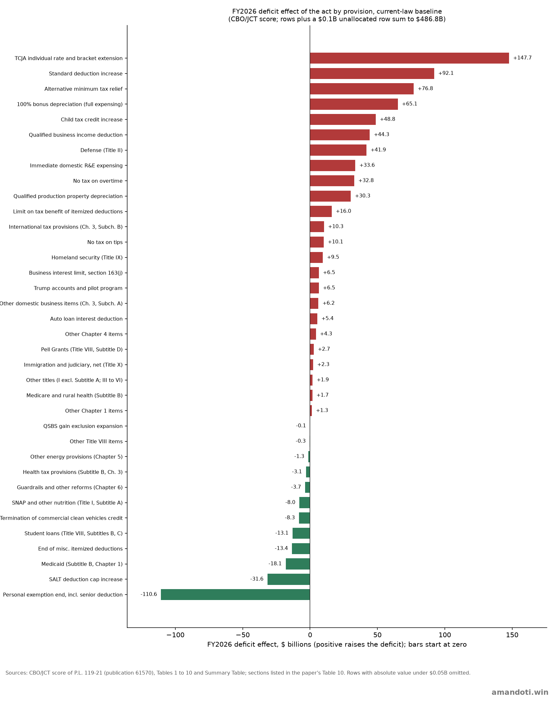

*Working paper. Not peer reviewed. Dollar figures are in billions of U.S. dollars unless stated. A positive deficit effect raises the deficit.*

**Keywords:** federal budget deficit, One Big Beautiful Bill Act, P.L. 119-21, corporate income tax, fiscal policy, CBO, JCT

**JEL codes:** H20, H62, E62

## Abstract

The federal budget deficit was $1,992.5 billion in fiscal year 2026, which is $217.1 billion (12.2%) above FY2025. This paper estimates how much of the deficit, and of its increase, traces to the 2025 reconciliation act, P.L. 119-21 (OBBBA). It uses the Congressional Budget Office (CBO) and Joint Committee on Taxation (JCT) scores of the act, JCT's current-policy baseline, CBO's January 2025 and February 2026 projections, and Treasury and Bureau of Economic Analysis (BEA) data.

The answer depends on how the question is framed. As a level, the act's scored FY2026 effect is $486.8 billion against a current-law baseline (24% of the deficit) or $275.7 billion against a current-policy baseline (13.8%). As a change from FY2025, the scored effect rises by $303.9 billion, or 140% of the increase, and that figure includes the non-recurrence of a one-time $131 billion student-loan entry recorded in September 2025, which is part of the act's effect. As a memo, the author's own subtraction of that entry gives $172.9 billion, or 80%. Removing the act's FY2026 effect gives a deficit of $1,491 billion to $1,717 billion (4.6% to 5.3% of GDP), with a base case of $1,506 billion (4.7%), against 6.2% actual.

Corporate income tax receipts fell $70.7 billion (15.6%). CBO attributes the decline in part to the act's larger investment deductions, and its Outlook also names the end of deemed-repatriation payments. The evidence supports the act as the largest single driver but does not support attributing the entire decline to it. All effects attributed to the act are enactment-date static projections, not measured outcomes.

*AI disclosure: Generative AI assisted with data collection, the calculation model and charts, and drafting. The author directed the analysis and is responsible for all content.*

## 1. Introduction

Fiscal year 2026 ended with a deficit of $1,992.5 billion, up from $1,775.4 billion in FY2025 (Treasury, Monthly Treasury Statement [1]). CBO reports the same increase as $218 billion on preliminary data [2]. Outlays rose $385.8 billion to $7,395.8 billion and receipts rose $168.7 billion to $5,403.3 billion.

The 2025 reconciliation act extended and modified the 2017 individual tax cuts, expanded business expensing, changed student-loan and health-program spending, and made other changes. Corporate income tax receipts fell in FY2026 even as CBO reports corporate income rose, and CBO links part of that fall to the act [2]. This raises three questions:

1. How much of the FY2026 deficit, and of its increase over FY2025, is attributable to the act?
2. How much of the fall in corporate receipts is attributable to the act, and what would receipts have been without it?
3. What would the FY2026 deficit have been without the act?

The paper answers each with a stated baseline and states where the answer is a judgment rather than a measurement. Section 2 describes the data and method. Section 3 presents the act's scored effect as a level and as a change. Section 4 examines corporate receipts. Section 5 bridges the change in the deficit. Section 6 removes the act's effect from the FY2026 deficit. Section 7 states limitations.

**Table 1. Three framings of the act's share of the deficit**

| Framing | Baseline | Effect of the act | % of FY2026 deficit | % of $217.1B increase | Source |
|---|---|---|---|---|---|
| Level | Current law (2017 individual cuts expire on schedule) | **+$486.8B** (outlays +$26.3B, revenue loss $460.5B) | 24.4% | n/a | [3] |
| Level | Current policy (existing tax rates continue) | **+$275.7B** (outlays +$21.2B, revenue loss $254.5B) | 13.8% | n/a | [3], [5] |
| Change from FY2025 | Current policy | **+$303.9B** (outlays +$174.0B, revenue loss +$129.8B) | 15.3% | 140.0% | [3], [5] |
| Memo (author's own subtraction): change from FY2025 excluding the one-time FY2025 student-loan entry | Current policy | +$172.9B | 8.7% | 79.6% | [2], [3], [5] |
| Change from FY2025 | Current law | +$507.9B (outlays +$178.4B, revenue loss +$329.6B) | 25.5% | 233.9% | [3] |
| Deficit without the act (base) | Current law, FY2026 effect removed | **$1,505.6B (4.7% of GDP)** | n/a | n/a | [1], [3], [9] |
| Deficit without the act (range) | Current policy to current law plus debt service | **$1,491.5B to $1,716.8B** (4.6% to 5.3% of GDP) | n/a | n/a | [1], [3], [4], [9] |

## 2. Data and method

**Data.** Realized FY2025 and FY2026 budget data come from the September 2026 Monthly Treasury Statement (MTS), Tables 3, 4 and 9 [1]. CBO's September 2026 Monthly Budget Review supplies definitions, timing notes and the student-loan entry [2]. The act's budgetary effects are CBO and JCT's enactment-date scores, with revenue estimated by JCT and outlays by CBO, measured against CBO's January 2025 baseline [3]. JCT's estimate against a current-policy baseline [5] and CBO's debt-service estimate [4] supplement them. The corporate analysis uses CBO's February 2026 Outlook [6], CBO's January 2025 projections [7] and CBO's May 2026 note on filing-season collections [8], together with BEA corporate profits and GDP obtained through FRED [9].

Treasury and CBO agree to rounding. CBO reports a $1,993 billion deficit and a $218 billion increase on preliminary data. The MTS reports $1,992.5 billion and $217.1 billion. This paper uses the MTS figures as the base and states percentages against $217.1 billion.

**Approach.**

1. State the act's scored FY2026 effect as a level on two baselines: current law, in which the 2017 individual tax cuts expire on schedule, and current policy, in which existing tax rates continue.
2. Convert the level to a year-over-year change by subtracting the act's scored FY2025 effect. The current-policy baseline is the like-for-like choice because FY2025 was already under the existing rates.
3. Bridge the change in the actual deficit from FY2025 to FY2026 using the act's outlay and revenue effects, with net interest, other outlays and other revenue as residuals that absorb everything else.
4. Test the corporate decline with three families of counterfactuals.
5. Remove the act's FY2026 effect from the actual deficit, holding the economy constant.

Formulas, inputs and assumptions are listed in Appendix A.

## 3. The act's scored effect

### 3.1 Scored effect by year

**Table 2. Scored effect of the act ($B, positive raises the deficit)**

| | FY2025 | FY2026 | Change, FY2025 to FY2026 |
|---|---|---|---|
| Outlays (CBO) | −152.0 | +26.3 | +178.4 |
| Revenue loss, current-law baseline (JCT) | +130.9 | +460.5 | +329.6 |
| **Deficit effect, current-law baseline** | −21.1 | **+486.8** | **+507.9** |
| Outlays, current-policy basis (CBO outlays less outlay effects of tax provisions that JCT also scores) | −152.8 | +21.2 | +174.0 |
| Revenue loss, current-policy baseline (JCT, plus non-Title VII revenue and Medicaid-related revenue effects) | +124.6 | +254.5 | +129.8 |
| **Deficit effect, current-policy baseline** | −28.2 | **+275.7** | **+303.9** |
| Memo: debt service on the above (CBO) | +0.4 | +14.1 | +13.7 |
| Memo: one-time September 2025 student-loan entry [2] | −131.0 | 0 | +131.0 |

Sources: [3], [4], [5]; memo entry from [2], p. 5.

The FY2025 outlay effect is negative because the Department of Education recorded a $131 billion reduction in outlays in September 2025 from the act's student-loan program changes [2]. That entry lowered FY2025 outlays and did not recur in FY2026.

### 3.2 Level and change

The published CBO score of +$486.8 billion is a level measured against a counterfactual law in which the 2017 individual tax cuts expire on schedule. Most of the $460.5 billion revenue loss in that score is the cost of not letting rates revert. It is not a change from FY2025, when those rates were already in force.

The $217.1 billion increase in the deficit is a change between two years. A like-for-like comparison therefore uses a baseline in which existing rates continue, and subtracts the act's FY2025 effect. That gives a change of +$303.9 billion, or 140.0% of the increase. Of this, outlays contribute +$174.0 billion (57%) and revenue loss +$129.8 billion (43%).

The current-policy rows count each provision once. CBO's outlay total includes outlay effects of tax provisions (mainly refundable credits) that JCT also includes in its net tax effect: $5.1 billion in FY2026 and $0.8 billion in FY2025. Adding the two series directly would count them twice, so they are removed from the outlay side. Medicaid-related revenue effects of $0.5 billion in FY2026 appear in CBO's section rows but not in the JCT-based revenue total, and are added to the revenue side (Section 6.1).

The 140% figure includes the effect of a one-time accounting entry. In September 2025 the Department of Education recorded a $131 billion reduction in outlays from the act's student-loan program changes [2]. The entry is part of the act's FY2025 effect, so it is included in the act's scored effect and in the 140% headline. Its absence from FY2026 contributes $131 billion, or 75% of the $174.0 billion outlay swing, to the change from FY2025 (Section 6.1 shows the student-loan line). As a memo, subtracting the entry leaves an outlay swing of +$43.0 billion and a change of +$172.9 billion, or 80% of the increase. This subtraction is the author's own arithmetic on two sourced figures and is not a CBO estimate.

A share above 100% does not mean the act caused more than all of the change. The act's change is one component of a $217.1 billion net movement. Individual and payroll tax collections rose $253 billion, and other items moved as well, so factors other than the act netted to a deficit reduction of $86.8 billion (Section 5).

### 3.3 Share under each view

**Table 3. Share of the increase under each view**

| View | $B | % of $217.1B | % of CBO's $218B | % of FY2026 deficit |
|---|---|---|---|---|
| (a) Level, current-law baseline | 486.8 | 224% | 223% | 24.4% |
| (b) Level, current-policy baseline | 275.7 | 127% | 126% | 13.8% |
| (c) Change, current-law baseline | 507.9 | 234% | 233% | 25.5% |
| (d) Change, current-policy baseline | 303.9 | 140% | 139% | 15.3% |
| Memo (d′), author's own subtraction: as (d), excluding the one-time FY2025 student-loan entry | 172.9 | 80% | 79% | 8.7% |

## 4. Corporate income tax

### 4.1 Facts

- Corporate receipts fell from $452.1 billion in FY2025 to $381.4 billion in FY2026, a decline of $70.7 billion (15.6%) [1]. Gross receipts fell $43.5 billion ($486.4 billion to $442.9 billion) and refunds rose $27.2 billion ($34.3 billion to $61.5 billion).
- CBO states that the act reduced projected corporate receipts by $98 billion in FY2026 and $352 billion over 2026 to 2035, and reduced individual receipts by $361 billion in FY2026 [6]. The $98 billion is a level effect against pre-act law. It exceeds the realized $70.7 billion year-over-year decline because the act also lowered FY2025 receipts.
- CBO attributes the 2026 decline to the act's larger investment deductions, which offset increases that would otherwise have been expected given the rise in corporate income [2]. CBO gives no dollar split in that report.
- CBO also names the end of scheduled deemed-repatriation payments as a driver: the largest installments fell in 2024 and 2025, and many firms made their final payments in FY2025 [6], [8]. CBO gives no dollar figure for this, and none was found in IRS, Treasury or JCT material, so its size is not known.
- CBO's January 2025 baseline, which predates the act, had corporate receipts falling from $523.7 billion in FY2025 to $495.1 billion in FY2026, a decline of $28.6 billion (5.5%) [7]. CBO therefore already expected a decline without the act.
- CBO's February 2026 baseline, which includes the act, projected FY2026 corporate receipts at $404.0 billion, a $48.1 billion decline [6]. Actual receipts came in $22.6 billion below that, and CBO's May 2026 note reports that the decline was running larger than projected [8].

### 4.2 Profit growth

Counterfactual receipts based on profit growth use BEA corporate profits with inventory valuation and capital consumption adjustments (NIPA Table 1.12) [9]. This is an economic-depreciation basis. The series without those adjustments uses tax-return depreciation, so it already reflects the larger deductions and would understate a no-expensing counterfactual.

Case B uses calendar 2025 vs calendar 2024 profit growth of +1.8%, the tax year behind much of FY2026 payments. Profit growth in 2026 periods is not used because it does not match the tax year being evaluated. The case assumes receipts move one-for-one with profits, which has not been verified. It also ignores the deemed-repatriation roll-off, so it overstates what receipts would have been without the act.

### 4.3 Counterfactuals

**Table 5. FY2026 corporate receipts without the act ($B)**

| Case | Formula | Implied FY2026 receipts | Revenue difference | Deficit effect | Deficit if applied |
|---|---|---|---|---|---|
| A: add back the full 15.6% loss | 452.1 | 452.1 | +70.7 | −70.7 | 1,921.8 |
| B: FY2025 grown by tax-year profit growth (+1.8%) | 452.1 × 1.018 | 460.2 | +78.8 | −78.8 | 1,913.7 |
| C1: scored change in business provisions × implied corporate share (65%) | 381.4 + 51.6 × 0.646 | 414.7 | +33.3 | −33.3 | 1,959.1 |
| C2: CBO February 2026 baseline-implied decline | 381.4 + (452.1 − 404.0) | 429.5 | +48.1 | −48.1 | 1,944.4 |
| C3: CBO January 2025 (pre-act) path applied to FY2025 actual | 452.1 × 495.1 / 523.7 | 427.4 | +46.0 | −46.0 | 1,946.5 |
| C4: CBO-reported FY2026 corporate effect of the act (level) | 381.4 + 98.0 | 479.4 | +98.0 | −98.0 | 1,894.5 |

Case A adds back the whole decline. Case B grows FY2025 receipts by tax-year corporate profit growth. Cases C use CBO and JCT scoring to estimate the portion attributable to the act.

- **C1** multiplies the scored change between FY2025 and FY2026 in the act's business provisions (sections 70301 to 70313 and 70321 to 70354), −$51.6 billion across all taxpayers, by a corporate share. The share is derived from CBO's figures: its $98 billion corporate effect divided by the $151.7 billion FY2026 all-taxpayer business-provision effect gives 65%. This is a lower bound on the gross share because the $98 billion is net of corporate offsets such as the repeal of wind and solar credits.
- **C2 and C3** are year-over-year proxies for the part of the decline attributable to the act. C3 removes CBO's pre-act expectation (−$28.6 billion) from the actual change.
- **C4** is the level answer to what FY2026 receipts would have been without the act: the actual figure plus CBO's own estimate. It is close to case B ($460 billion), which is a useful cross-check.

Applying case A, the increase in the deficit would have been $146.4 billion instead of $217.1 billion. Under case B it would have been $138.3 billion. Under cases C it would have been between $119 billion (C4) and $184 billion (C1).

**Figure 1. Corporate receipts under each counterfactual**

### 4.4 Is the whole decline attributable to the act?

**Table 6. Evidence on attributing the entire decline to the act**

| Evidence | Bears on the claim | Strength |
|---|---|---|
| CBO attributes the decline to the act's larger deductions offsetting expected growth [2] | Supports | Strong, qualitative |
| CBO's estimate of the act's FY2026 corporate effect is $98B, larger than the whole $70.7B decline [6] | Supports the act as the largest driver | Strong, but a level effect. FY2025 was also reduced by the act, so it does not map one-for-one to the change |
| CBO's pre-act baseline already had receipts falling $28.6B in FY2026, and CBO names the end of deemed-repatriation installments as a driver [6], [7] | Against | Strong on direction. The size of the roll-off is not known |
| Year-over-year decline attributable to the act on CBO-based proxies: $33B to $48B (C1 to C3), or 47% to 68% of $70.7B | Against | Moderate |
| Actual receipts were $22.6B below CBO's baseline that already includes the act [8] | Unexplained residual (more effect of the act, timing, or profit mix) | Cannot be attributed with available data |
| BEA profits grew only 1.8% on a calendar 2025 vs 2024 basis | Weakens the claim that record profits would have raised receipts for the tax year behind much of FY2026 payments | Moderate |

The act is the largest single driver of the decline, and CBO's $98 billion figure supports that. Attributing the entire decline to the act is not supported. CBO's pre-act path and its stated deemed-repatriation roll-off imply a decline of roughly $25 billion to $30 billion that is unrelated to the act. That leaves about $33 billion to $48 billion (47% to 68%) attributable to the act on a year-over-year basis, with $22.6 billion unexplained against CBO's own baseline. Tax-year 2025 profit growth was only 1.8%, so rising profits do not by themselves explain an expected increase in receipts.

## 5. Bridge of the change in the deficit

**Table 7. From the FY2025 deficit to the FY2026 deficit ($B)**

| Step | $B | Basis |
|---|---|---|
| FY2025 deficit | 1,775.4 | MTS [1] |
| Act: outlay changes | +174.0 | Change in scored effect, FY2025 to FY2026 |
| Act: revenue loss (includes the corporate effect, counted once) | +129.8 | Current-policy baseline |
| Net interest (residual) | +114.2 | CBO definition: MTS gross interest less interest offsets. Includes about $13.7B of debt service on the act |
| Other outlay growth (residual) | +97.6 | Total outlay change (+$385.8B) less the act's outlays and net interest |
| Other revenue growth, including net customs duties (residual) | −298.6 | Actual revenue change (+$168.7B) plus the act's revenue loss, signed for the deficit |
| **FY2026 deficit** | **1,992.5** | MTS [1] |

The three residual bars sum to −$86.8 billion, which equals $217.1 billion less $303.9 billion. The bridge reproduces the FY2026 deficit to within $0.001 billion, and the replication script checks this on every run. The two residual plug bars are derived, not measured: each is the actual total change less the named items. They contain small effects of the act outside the score's scope and every non-act change in the budget.

The act's corporate effect is part of its revenue-loss bar and is not added again. The alternative view that treats the whole $70.7 billion corporate decline as the act's effect is 32.6% of the increase. That figure is an upper bound for the corporate piece, omits the act's other effects, and includes non-act drivers.

**Figure 2. Bridge from the FY2025 deficit to the FY2026 deficit**

Table 8 in Appendix C lists the principal line-item changes behind the residuals.

## 6. The FY2026 deficit without the act

The estimate is static: tariffs, tariff refunds and the economy are held at actual values, there is no macroeconomic feedback, and interest changes only in the stated debt-service case. FY2026 GDP is about $32.25 trillion, using BEA data through 2025Q4 to 2026Q2 [9] and an estimate for Q3 2026. BEA's advance Q3 estimate is scheduled for October 29, 2026, so Q3 is provisional. The estimate uses +1.6% quarter-over-quarter nominal growth, based on the Atlanta Fed's GDPNow real growth estimate of 3.7% on October 6 [10] and an assumed deflator of about 3%, which has not been verified. Across Q3 growth of 1.1% to 2.1%, FY2026 GDP ranges from $32.21 trillion to $32.29 trillion, and the actual deficit is 6.17% to 6.19% of GDP, consistent with the 6.2% CBO reported [11].

**Table 9. FY2026 deficit with the act's effect removed**

| Case | Effect removed ($B) | Deficit ($B) | % of GDP |
|---|---|---|---|
| Actual FY2026 | 0 | 1,992.5 | 6.2% |
| Low removal (current-policy baseline; existing tax rates continue) | 275.7 | 1,716.8 | 5.3% |
| Base (CBO/JCT score against current law) | 486.8 | 1,505.6 | 4.7% |
| High removal (base plus debt service of $14.1B) | 501.0 | 1,491.5 | 4.6% |

**Figure 3. FY2026 deficit with the act's FY2026 effect removed**

The base case describes a world in which the 2017 individual tax cuts expired. The low case describes a world without the act in which those cuts continue. Which is the right counterfactual is a policy judgment, so both are shown. For comparison, the FY2025 deficit with the act's FY2025 effect removed is $1,796.5 billion.

### 6.1 Provision-level composition of the act's FY2026 effect

The act's FY2026 effect used in Sections 3 and 6 is the sum of many provisions. Table 10 shows the FY2026 deficit effect of each requested provision and of the remaining items. Remaining items are grouped as the sources group them: JCT chapters for tax provisions and CBO titles and subtitles for outlays. Positive values raise the deficit. The current-law column is measured against CBO's January 2025 baseline, in which the 2017 individual tax cuts expire on schedule; revenue is estimated by JCT and outlays by CBO [3]. The current-policy column is measured against JCT's baseline in which existing tax rates continue [5]. It covers tax provisions only. The outlay rows are CBO scores that do not depend on the tax baseline and appear in both columns. All estimates are static.

**Table 10. FY2026 deficit effect of the act by provision ($B)**

| Provision | FY2026, current law | FY2026, current policy | Source |
|---|---|---|---|
| *Tax provisions* | | | |
| TCJA individual rate and bracket extension | 147.7 | 4.9 | [3] T7, §70101; [5] p.1, Ch.1 #1 |
| Standard deduction increase | 92.1 | 19.0 | [3] T7, §70102; [5] p.1, Ch.1 #2 |
| Personal exemption end, incl. senior deduction | −110.6 | 23.1 | [3] T7, §70103; [5] p.1, Ch.1 #3 (includes temporary senior deduction) |
| Child tax credit increase | 48.8 | 10.0 | [3] T7, §70104; [5] p.1, Ch.1 #4 |
| Qualified business income deduction | 44.3 | 0.4 | [3] T7, §70105; [5] p.1, Ch.1 #5 |
| Alternative minimum tax relief | 76.8 | −0.7 | [3] T7, §70107; [5] p.1, Ch.1 #7 |
| End of misc. itemized deductions | −13.4 | 0.0 | [3] T7, §70110; [5] p.1, Ch.1 #10 |
| Limit on tax benefit of itemized deductions | 16.0 | −1.4 | [3] T7, §70111; [5] p.1, Ch.1 #11 |
| SALT deduction cap increase | −31.6 | 34.2 | [3] T7, §70120; [5] p.2, Ch.1 #20 |
| Other Chapter 1 items | 1.3 | 0.3 | [3] T7, §§70106, 70108, 70109, 70112-70119; [5] p.2, Ch. 1 less listed |
| No tax on tips | 10.1 | 10.1 | [3] T7, §70201; [5] p.2, Ch.2 #1 |
| No tax on overtime | 32.8 | 32.8 | [3] T7, §70202; [5] p.2, Ch.2 #2 |
| Auto loan interest deduction | 5.4 | 5.4 | [3] T7, §70203; [5] p.2, Ch.2 #3 |
| Trump accounts and pilot program | 6.5 | 6.4 | [3] T7, §70204; [5] p.2, Ch.2 #4 |
| 100% bonus depreciation (full expensing) | 65.1 | 54.2 | [3] T7, §70301; [5] p.2, Ch.3 Sub.A #1 |
| Immediate domestic R&E expensing | 33.6 | 33.6 | [3] T7, §70302; [5] p.2, Ch.3 Sub.A #2 |
| Business interest limit, section 163(j) | 6.5 | 6.5 | [3] T7, §70303; [5] p.2, Ch.3 Sub.A #3 |
| Qualified production property depreciation | 30.3 | 30.3 | [3] T7, §70307; [5] p.3, Ch.3 Sub.A #7 |
| Other domestic business items (Ch. 3, Subch. A) | 6.2 | 3.7 | [3] T7, §§70304-70306, 70308, 70309; [5] pp.2-3, Ch.3 Sub.A #4-6, 8, 9 |
| International tax provisions (Ch. 3, Subch. B) | 10.3 | 1.1 | [3] T7, §§70311-70354; [5] p.3, Ch. 3 less Subchapter A items |
| QSBS gain exclusion expansion | −0.1 | −0.1 | [3] T7, §70431; [5] p.5, Ch.4 Sub.D #1 |
| Other Chapter 4 items | 4.3 | −0.8 | [3] T7, §§70401-70439 less 70431; [5] p.5, Ch. 4 less QSBS |
| Termination of commercial clean vehicles credit | −8.3 | −8.3 | [3] T7, §70503; [5] p.5, Ch.5 Sub.A #3 |
| Other energy provisions (Chapter 5) | −1.3 | −1.3 | [3] T7, §§70501-70531 less 70503; [5] p.6, Ch. 5 less #3 |
| Guardrails and other reforms (Chapter 6) | −3.7 | −3.7 | [3] T7, §§70601-70607; [5] p.7, Ch. 6 |
| Health tax provisions (Subtitle B, Ch. 3) | −3.1 | −4.5 | [3] T7, §§71301-71308 (revenue, outlay rows); [5] p.7, Subtitle B Ch.3 |
| **Subtotal, tax provisions** | **466.1** | **255.1** | Sum of rows above |
| *Outlay provisions (CBO; same in both columns)* | | | |
| Medicaid (Subtitle B, Chapter 1) | −18.1 | −18.1 | [3] T7, §§71101-71121 (sum of rows; no subtotal in source) |
| Medicare and rural health (Subtitle B) | 1.7 | 1.7 | [3] T7, §§71201-71203 and 71401 |
| SNAP and other nutrition (Title I, Subtitle A) | −8.0 | −8.0 | [3] T1, Subtitle A |
| Student loans (Title VIII, Subtitles B, C) | −13.1 | −13.1 | [3] T8, Subtotals for Subtitles B and C |
| Pell Grants (Title VIII, Subtitle D) | 2.7 | 2.7 | [3] T8, Subtitle D |
| Other Title VIII items | −0.3 | −0.3 | [3] T8, Subtitles A, E, F, G, H and Total Interactions |
| Defense (Title II) | 41.9 | 41.9 | [3] T2 |
| Homeland security (Title IX) | 9.5 | 9.5 | [3] T9 |
| Immigration and judiciary, net (Title X) | 2.3 | 2.3 | [3] T10, outlays less Subtitle A revenues |
| Other titles (I excl. Subtitle A; III to VI) | 1.9 | 1.9 | [3] T1 less Subtitle A; Summary Table (Titles III, IV); Tables 5, 6 |
| **Subtotal, outlay provisions** | **20.6** | **20.6** | Sum of rows above |
| *Reconciling rows* | | | |
| Unallocated: Title VII total less its section rows (source rounding) | 0.1 | 0.0 | [3] T7 totals less section rows |
| Interactions among titles | 0.0 | 0.0 | [3] Summary Table |
| **Total: the act's FY2026 deficit effect** | **486.8** | **275.7** | Section 3.1, Table 2 |

Sources: [3] is CBO's cost estimate, publication 61570 (workbook tables 1 to 10 and the Summary Table; T7 is Table 7, Title VII, and § is the section number). [5] is JCX-34-25, cited by PDF page (p.), chapter (Ch.), subchapter (Sub.) and item (#). Rows may not sum to totals because of rounding. Table 7 gives each tax provision a revenue row and an outlay row; the current-law column uses their difference.

**Figure 4. FY2026 deficit effect by provision, current-law baseline**

**Reconciliation.** The current-law rows sum to $486.8 billion, the total used in this paper, with one unallocated row of $0.1 billion, the amount by which CBO's Title VII totals exceed the sum of its section rows [3]. The current-policy rows sum to $275.7 billion, the total used in Tables 1 to 3, with no reconciling rows. That total counts each provision once. A direct sum of CBO's total outlays ($26.3 billion) and JCX-34-25's net tax effect would be $280.3 billion, which counts twice the outlay effects of tax provisions that JCT scores (JCX-34-25 footnote 1; CBO's Table 7 outlay rows for these provisions total $5.1 billion) [3], [5]. It also omits $0.5 billion of Medicaid-related revenue effects that appear in CBO's section rows [3]. JCT's net total for the same provisions against present law (−$464.6 billion) differs from CBO's revenue total (−$461.6 billion) by $3.1 billion, and JCT's footnote 1 lists $3.5 billion of outlay effects in its FY2026 net figures [12]. CBO's outlay rows for these provisions total $5.1 billion, mainly because CBO estimates the health-credit interaction line at $1.7 billion against JCT's $0.2 billion [3], [12]. The FY2025 adjustment is $0.8 billion.

**Student loans and the headline change.** The student-loan rows (Title VIII, Subtitles B and C) score at −$150.0 billion in FY2025 and −$13.1 billion in FY2026, a change of +$136.9 billion, or 45.1% of the +$303.9 billion change from FY2025 [3]. CBO's September 2025 entry for the act's student-loan program changes was −$131 billion as recorded [2], or 43.1% of that change. The entry is part of the act's FY2025 effect and is included in the 140% headline. Memo, the author's own subtraction of the recorded entry: +$172.9 billion, or 80% of the increase.

**Interpretation.** Against current law, the largest rows are the extension and enhancement of the individual tax cuts (rates $147.7 billion, standard deduction $92.1 billion, AMT relief $76.8 billion, child tax credit $48.8 billion, qualified business income deduction $44.3 billion), partly offset by the termination of personal exemptions (−$110.6 billion) and the SALT cap increase (−$31.6 billion). Against current policy, the rates row falls to $4.9 billion and the personal exemption and SALT rows change sign (+$23.1 billion and +$34.2 billion), so those rows reflect the choice of baseline; the largest group is business provisions in Chapter 3 ($129.4 billion), followed by Chapter 1 ($89.7 billion) and Chapter 2, which covers tips, overtime, auto loan interest and Trump accounts ($54.8 billion). Outlay provisions net to $20.6 billion in either column, with defense ($41.9 billion) and homeland security ($9.5 billion) larger than the savings from Medicaid (−$18.1 billion), student loans (−$13.1 billion) and SNAP and nutrition (−$8.0 billion). CBO states that its score incorporates interactions among provisions within and among titles [3], so the rows do not sum independently and are not the effect of enacting or repealing a single provision alone.

The temporary senior deduction is part of the Section 70103 row and is not scored separately in [3] or [5], so it is not shown on its own. CBO's table has no chapter subtotal for Medicaid; the Medicaid row is the sum of Sections 71101 to 71121.

## 7. Limitations

1. **No realized effect of the act has been published.** Every figure attributed to the act, including CBO's $98 billion corporate estimate, is a projection against an older baseline. The bridge reconciles to the actual deficit only because the residuals are plugs.
2. **Baseline choice changes the answer** from $276 billion to $508 billion, and one-time entries move the year-over-year figure by $131 billion. This paper uses the baseline that matches a year-over-year question and reports the others.
3. **The deemed-repatriation roll-off is named by CBO but not sized.** This limits how precisely the corporate decline can be divided between the act and other causes.
4. **Tariffs, refunds and the economy are held at actual values.** Interactions between tax policy, tariffs and profits are not modeled, and the analysis is partial equilibrium.
5. **Q3 2026 GDP is not yet published.** Its effect on the deficit-to-GDP ratio is under 0.02 percentage points.
6. **Attribution is not causation.** The act and the economy interact, for example through profits and income-tax receipts.
7. **Scores are tied to enactment-date legislation.** The JCT current-policy estimate is the Senate-passed version, tax provisions only, which the House then passed. Medicaid and SNAP savings phase in later, so the FY2026 outlay effect for those titles is small (Title VII outlays −$11.7 billion).

8. **Provision rows have source limits.** The extra senior deduction is not scored separately in the sources and is included in the personal exemption row. The Medicaid row is a sum of section rows. JCX-34-25 does not cover Medicaid, Medicare or other outlay provisions, so the current-policy column repeats the CBO outlay scores. The current-policy total in Tables 1 to 3 removes $5.1 billion (FY2026) and $0.8 billion (FY2025) of tax-provision outlay effects that CBO and JCT both score, using CBO's outlay rows (Section 6.1).

**Replication.** A model script, a table of every input with its source, and a results file accompany this paper. The script recomputes all results and charts and fails if the bridge does not sum to the FY2026 deficit. Copies of the Treasury statement and the CBO Monthly Budget Review are archived with the replication materials.

**License.** Copyright 2026 ncx, amandoti.win. Text and charts are licensed under CC BY 4.0 (https://creativecommons.org/licenses/by/4.0/). The model script is licensed under the MIT License.

## Appendix A. Formulas and assumptions

| Item | Formula or assumption | Status |
|---|---|---|
| Change in deficit | 1,992.473 − 1,775.369 = 217.104 | Verified (MTS) |
| Act, change from FY2025 (primary) | [outlays FY26 − outlays FY25] − [revenue effect FY26 − revenue effect FY25], current-policy baseline = 174.036 + 129.845 = 303.881 | Inputs verified; baseline choice is a judgment |
| Memo: act, change excluding one-time entry (author's own subtraction) | 303.881 − 131.0 = 172.881 | Derived; $131B entry verified (CBO MBR p. 5) |
| Current-policy revenue effect | JCX-34-25 Title VII total (−255.056 in FY26; −124.612 in FY25) plus non-Title VII revenue from the CBO score, plus Medicaid-related revenue effects (Secs. 71101 to 71121, +0.470 in FY26). CBO outlays are reduced by the outlay effects of Subtitle A and health-tax provisions that JCT also scores (5.144 in FY26; 0.828 in FY25) | Verified |
| Whole corporate decline as the act's effect | (452.089 − 381.415) / 217.104 = 32.6% | Inputs verified |
| Residual | 217.104 − 303.881 = −86.777 = net interest 114.215 + other outlays 97.563 + other revenue (including customs) −298.556 | Derived |
| Net interest | MTS gross interest less interest offsets | Matches CBO |
| Corporate B | 452.089 × (1 + g), g = 1.8% from BEA profits with IVA and CCAdj, calendar 2025 vs 2024 | Profits verified; one-for-one pass-through not verified |
| Corporate C1 | 381.415 + 51.6 × (98 / 151.7) | Inputs verified; share derived |
| Corporate C2 | 381.415 + (452.089 − 404.0) | Inputs verified |
| Corporate C3 | 452.089 × 495.1 / 523.7 | Inputs verified |
| Corporate C4 | 381.415 + 98.0 | Input verified |
| FY2026 GDP | Mean of 2025Q4 to 2026Q3 quarterly GDP; Q3 = Q2 × 1.016 | Q3 provisional |
| Deficit without the act | 1,992.473 − effect | Derived |
| Provision rows (Section 6.1) | Current law: deficit effect = outlays − revenues for each Table 7 section row [3]. Current policy: − (JCX-34-25 net effect) for tax provisions [5]; CBO outlay rows unchanged. Chapter remainders = source chapter total − listed rows. Rows sum to $486.839B (current law, including the unallocated row) and $275.652B (current policy) | Inputs verified; remainders derived |

## Appendix B. Reconciling CBO and Treasury

- **Deficit.** CBO: $1,993 billion, up $218 billion, on preliminary data. Treasury: $1,992.5 billion, up $217.1 billion. The difference is rounding.
- **Net interest.** CBO reports an increase of $115 billion (from $1,028 billion to $1,143 billion), which equals MTS gross interest on Treasury debt less undistributed interest receipts. The MTS net interest function line (+$81.4 billion) nets in other interest receipts. Both are correct under their own definitions.
- **Payroll taxes.** CBO reports $1,815 billion on preliminary data. The MTS reports social insurance receipts of $1,811.8 billion. The difference is small revisions.
- **Calendar timing.** CBO adjusts monthly comparisons only. Payments were shifted from September to August 2025 because of the September 1, 2025 holiday, but both months fall in FY2025, so no adjustment to the full-year $217 billion is needed. October 1 fell on a weekday in 2024, 2025 and 2026, so no payments crossed a fiscal-year boundary.

## Appendix C. Principal line-item changes

**Table 8. Changes in reported lines, FY2025 to FY2026 ($B, positive raises the deficit)**

| Line | Change | Source |
|---|---|---|
| Net interest (CBO definition) | +114.2 (MTS function line: +81.4) | [2] Table 3; [1] Tables 3 and 9 |
| Social Security | +86.4 | [1] Table 9 (CBO: +$86B) |
| Medicare | +75.9 (CBO: +$77B, net of offsets) | [1] Table 9 |
| Health, including Medicaid | +46.7 (CBO Medicaid: +$55B) | [1] Table 9 |
| National defense | +48.5 | [1] Table 9 |
| Veterans benefits | +39.0 | [1] Table 9 |
| Education | +36.5 (reflects the −$131B September 2025 student-loan entry not recurring) | [1] Table 9; [2] p. 5 |
| Administration of justice | +24.7 | [1] Table 9 |
| Natural resources and environment | −31.2 | [1] Table 9 |
| Community and regional development | −22.1 | [1] Table 9 |
| Individual income taxes | −189.5 (more revenue) | [1] Table 3 |
| Payroll (social insurance) | −63.5 (more revenue) | [1] Table 3 |
| Corporate income taxes | +70.7 (less revenue) | [1] Table 3 |
| Estate and gift taxes | −9.3 (more revenue) | [1] Table 3 |
| Other revenue lines, including net customs duties and miscellaneous | +22.9 net | [1] Table 3 |

These are gross changes in reported lines and include small effects of the act, which is why the bridge presents the net residual as plugs. Function-line outlays sum to $7,395.8 billion and revenue lines to $5,403.3 billion, with differences under $0.01 billion.

## References

1. U.S. Department of the Treasury, Bureau of the Fiscal Service. *Monthly Treasury Statement, September 2026* (Tables 3, 4 and 9). https://fiscaldata.treasury.gov/static-data/published-reports/mts/MonthlyTreasuryStatement_202609.pdf
2. Congressional Budget Office. *Monthly Budget Review: September 2026*. October 8, 2026. https://www.cbo.gov/publication/61985
3. Congressional Budget Office and Joint Committee on Taxation. *Estimated Budgetary Effects of Public Law 119-21, Relative to CBO's January 2025 Baseline*. July 21, 2025 (Summary Table and Tables 1 to 10, one per title; provision rows in Table 7). https://www.cbo.gov/publication/61570 ; workbook: https://www.cbo.gov/system/files/2025-07/61570-pl119-21-2025Recon-CLB.xlsx
4. Congressional Budget Office. *Effects on Deficits and the Debt of Public Law 119-21* (letter to Sen. Merkley). August 4, 2025. https://www.cbo.gov/publication/61466
5. Joint Committee on Taxation. *JCX-34-25: Estimated Revenue Effects Relative to the Current Policy Baseline of the Tax Provisions in Title VII*. July 1, 2025 (provision table, PDF pages 1 to 8; footnote 1 on outlay effects). https://www.jct.gov/publications/2025/jcx-34-25/
6. Congressional Budget Office. *The Budget and Economic Outlook: 2026 to 2036*. February 2026. https://www.cbo.gov/system/files/2026-02/61882-Outlook-2026.pdf. Data: https://www.cbo.gov/system/files/2026-02/51118-2026-02-Budget-Projections.xlsx
7. Congressional Budget Office. *Budget Projections, January 2025*, Table B-1. https://www.cbo.gov/system/files/2025-01/51118-2025-01-Budget-Projections.xlsx
8. Congressional Budget Office. *Revenue Collections Through the Individual Income Tax Filing Season*. May 21, 2026. https://www.cbo.gov/publication/62442
9. U.S. Bureau of Economic Analysis. NIPA Table 1.12 (corporate profits) and gross domestic product, via FRED series A053RC1Q027SBEA, A446RC1Q027SBEA and GDP, retrieved October 16, 2026. https://fred.stlouisfed.org/
10. Federal Reserve Bank of Atlanta. GDPNow, as reported by Trading Economics (3.7% real Q3 2026 growth on October 6, 2026; secondary source used only to size Q3 GDP). https://tradingeconomics.com/united-states/gdpnow
11. American Action Forum. *CBO: FY 2026 Budget Deficit Totaled $2 Trillion* (secondary source; cross-check of the 6.2% of GDP figure). https://www.americanactionforum.org/insight/cbo-fy-2026-budget-deficit-totaled-2-trillion/
12. Joint Committee on Taxation. *JCX-35-25: Estimated Revenue Effects Relative to the Present Law Baseline of the Tax Provisions in Title VII*. July 1, 2025 (NET TOTAL line and footnote 1, used to cross-check net and revenue totals). https://www.jct.gov/publications/2025/jcx-35-25/
